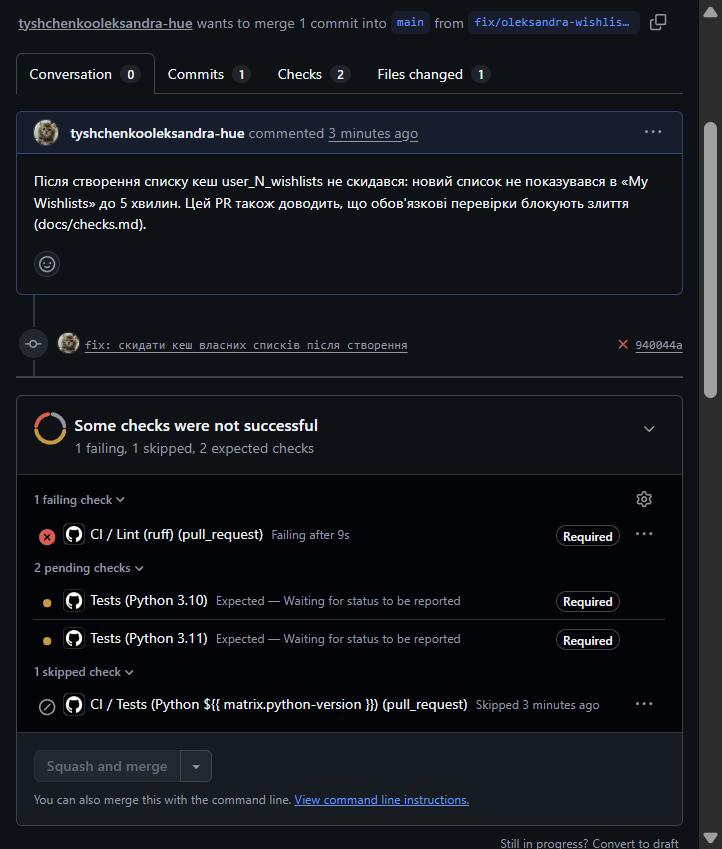
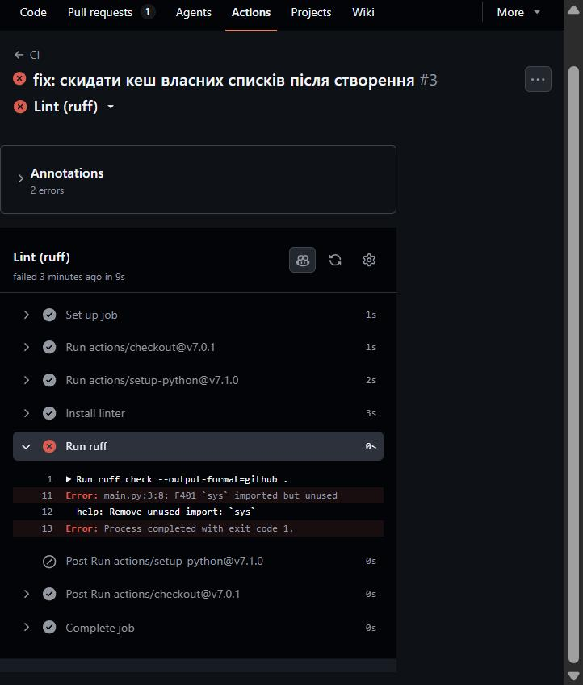
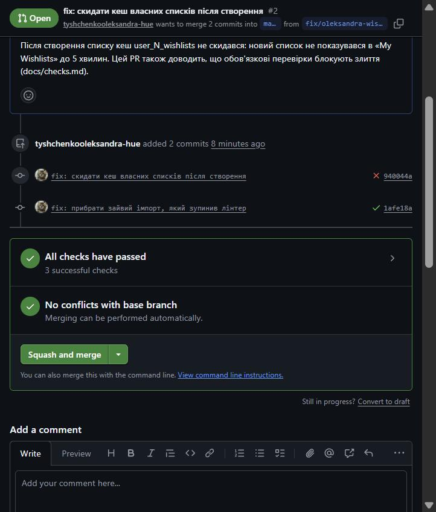

# Перевірки конвеєра: wishlist-api

## Обов'язкові перевірки блокують злиття

Ruleset `protect-main` вимагає `Lint (ruff)`, `Tests (Python 3.10)` і `Tests (Python 3.11)`.
Доказ — [PR #2](https://github.com/tyshchenkooleksandra-hue/wishlist-api/pull/2): у першому коміті навмисно залишено зайвий імпорт.

**1. Червона перевірка, кнопка злиття заблокована.** Лінтер упав, тому тести не запускалися: `Tests (Python 3.10)` і `Tests (Python 3.11)` чекають статусу, а без них злити не можна.

**2. Журнал із конкретним рядком помилки:** `main.py:3:8: F401 sys imported but unused`.

**3. Той самий PR після виправлення:** усі перевірки зелені, кнопка активна.

## Ефект кешу

| Прогін | Час |
|---|---|
| Без кешу (перший прогін PR #1) | 61 с |
| З кешем (повторний прогін того самого PR) | 53 с |

Найдовший крок — `Initialize containers` (запуск Postgres і Redis, близько 15 с): кеш pip його не прискорює.
